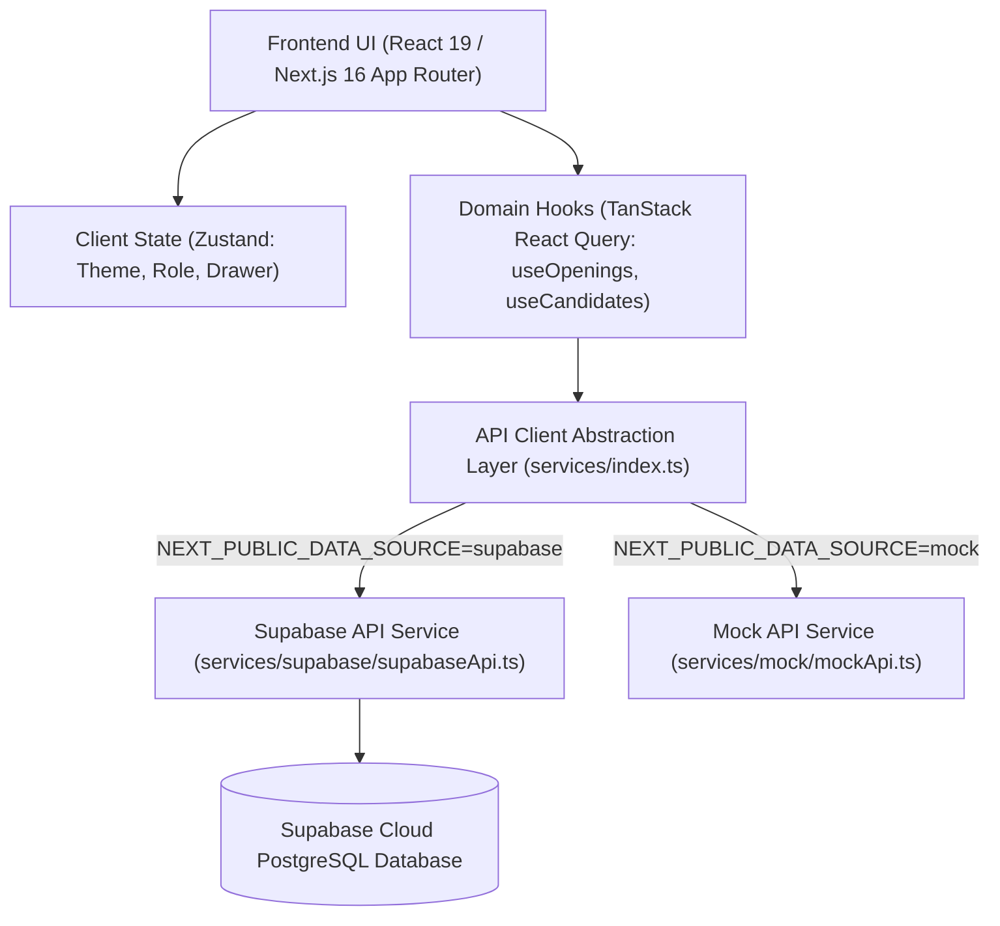

# 📘 HRO Recruitment & Onboarding System — Workflow & Developer Guide

> **Welcome!** HRO ek modern, high-performance Recruitment & Onboarding Operations Platform hai jisme **Next.js 16 (App Router)** frontend aur **Supabase (PostgreSQL Database)** backend live connected hai.
>
> Is document me aap seekhenge ki:
>
> 1. Complete hiring workflow kaise chalta hai aur use browser me kaise check/test karna hai.
> 2. Automated test scripts se backend workflows kaise verify karne hain.
> 3. Is codebase par naye features, APIs ya UI components kaise add karne hain.

---

## 📑 Table of Contents

1. [Architecture & Backend Overview](#-architecture--backend-overview)
2. [Quick Start (Local Setup)](#-quick-start-local-setup)
3. [Complete End-to-End Hiring Workflow](#-complete-end-to-end-hiring-workflow)
4. [How to Check & Test Workflows](#-how-to-check--test-workflows)
   - [Method A: Testing via Web UI (Browser)](#method-a-testing-via-web-ui-browser)
   - [Method B: Automated CLI Script Verification](#method-b-automated-cli-script-verification)
5. [Developer Guide: How to Work on This Codebase](#-developer-guide-how-to-work-on-this-codebase)
   - [Project Structure](#project-structure)
   - [Data Flow Architecture](#data-flow-architecture)
   - [Switching Between Supabase & Mock Data](#switching-between-supabase--mock-data)
   - [Adding a New Feature / Mutation](#adding-a-new-feature--mutation)
   - [Adding / Modifying Database Tables](#adding--modifying-database-tables)
6. [Database Schema Reference](#-database-schema-reference)
7. [Commands Cheat Sheet](#-commands-cheat-sheet)

---

## 🏛️ Architecture & Backend Overview



- **Frontend**: Next.js 16.4 (Turbopack), Tailwind CSS v4, Radix UI primitives, Lucide Icons, Sonner toasts.
- **State Management**: TanStack React Query v5 (server data cache & optimistic mutations) + Zustand v5 (UI state: current persona role, theme, mobile sidebar drawer).
- **Backend**: Supabase Cloud PostgreSQL with real-time query support.
- **Security & Auth**: Dual-persona role switcher (`HR Lead: Priya Sharma` vs `Hiring Manager: Arjun Kapoor`) with role-scoped navigation and actions.

---

## ⚡ Quick Start (Local Setup)

### 1. Prerequisites

- **Node.js**: v20 or higher
- **Package Manager**: `pnpm` (v9 or v10)

### 2. Environment Configuration

Project ke root me `.env.local` file already configured hai:

```env
NEXT_PUBLIC_DATA_SOURCE=supabase
NEXT_PUBLIC_SUPABASE_URL=https://ijcesduxnbgxjcteejbk.supabase.co
NEXT_PUBLIC_SUPABASE_ANON_KEY=sb_publishable_ezpArMfQi-1GiA5upxOPsA_-d8hzIAN
NEXT_PUBLIC_API_URL=http://localhost:3000/api
```

### 3. Run Development Server

Terminal me command run karein:

```bash
pnpm dev
```

Browser me open karein: **[http://localhost:3000](http://localhost:3000)**

---

## 🔄 Complete End-to-End Hiring Workflow

HRO ka complete recruitment funnel 7 seamless stages me divide kiya gaya hai:

```
[1. Job Opening Created]
         │
         ▼
[2. Candidate Sourced / Applied]
         │
         ▼
[3. Shared with Manager (Review Queue)]
    ├── Rejected ❌
    └── Shortlisted ✅
         │
         ▼
[4. Technical Interview (Schedule Slot & Video/Phone)]
    ├── Rejected ❌
    ├── On Hold ⏸️
    └── Selected ✅
         │
         ▼
[5. Offer Sent (Compensation & Notice Period)]
         │
         ▼
[6. Candidate Joined]
         │
         ▼
[7. Onboarding Roadmap (7 Standard Tasks across 3 Phases)]
```

### Stage Details:

1. **Requisition / Opening**:
   - HR ya Manager `/openings/new` par jaakar nayi vacancy create karta hai (Title, Department, Headcount, Budget ₹ LPA, Experience, Skills).
   - Opening live status `Open` ya `Sourcing` me chali jaati hai.
2. **Sourcing**:
   - Naye candidates LinkedIn, Naukri, Referrals se add hote hain aur opening se link hote hain.
3. **Manager Review (`/shortlist`)**:
   - Candidates `Shared with Manager` stage me aate hain.
   - Hiring Manager resume, CTC, notice period check karke ek click me **Shortlist** ya **Reject** karta hai.
4. **Interview Scheduling & Evaluation (`/interviews`)**:
   - Shortlist hone par candidate `Interview` stage me move hota hai.
   - Manager ya HR Google Meet/Phone slot schedule karta hai (Date, Time, Format).
   - Interview ke baad **Record Outcome** dialog se verdict enter hota hai: `Selected`, `On Hold`, ya `Rejected`.
5. **Offer & Placement**:
   - Selected candidates ko offer extend hota hai (`Offer Sent`).
   - Offer accept hone par candidate `Joined` mark hota hai.
6. **Onboarding Roadmap (`/onboarding`)**:
   - Jaise hi candidate `Offer Sent` ya `Joined` hota hai, wo Onboarding dashboard me Upcoming Hires table me dikhta hai.
   - **"Setup Standard Checklist"** button click karne par Supabase me 7 standard tasks 3 phases me create ho jaate hain:
     - **Before Joining**: Collect Documents (HR), System Accounts (HR), Laptop Setup (HR), First-week plan (Manager).
     - **Day 1**: Welcome & Orientation (HR), Buddy Assignment (Manager).
     - **First 30 Days**: 30-day Check-in (Manager).
   - Tasks ko live check/uncheck kiya ja sakta hai.
7. **Reports & Audit (`/reports`)**:
   - Monthly hiring velocity, funnel drop-off yield (27% yield), department quota aur sourcing channels live sync hote hain.
   - Har major action `activity_logs` table me audit trail ke roop me record hota hai.

---

## 🧪 How to Check & Test Workflows

### Method A: Testing via Web UI (Browser)

Browser me **http://localhost:3000** open karke step-by-step test karein:

#### Step 1: Persona Switch Karein (HR vs Manager)

- Bottom-left sidebar me **"Demo Role"** button (ya topbar profile dropdown) par click karein.
- **HR View**: Aapko complete pipeline, candidates directory, onboarding dashboard, aur reports dikhenge.
- **Manager View**: Requisitions, review queue (`Awaiting Your Review`), scheduled technical interviews aur scorecards dikhenge.

#### Step 2: Nayi Job Opening Create Karein

1. Left sidebar se **All Openings** (`/openings`) par jayein.
2. Top-right me **"+ New Opening"** button click karein.
3. Form fill karein:
   - Position Title: _Senior Fullstack Architect_
   - Department: _Engineering_
   - Location: _Bengaluru, India_
   - Headcount: _2_
   - Budget: _₹30 - 45 LPA_
4. **"Create Requisition"** submit karein. Toast notification aayegi aur Supabase me record create ho jayega.

#### Step 3: Candidates Directory & Profile Sheet Check Karein

1. Sidebar se **Candidates** (`/candidates`) open karein.
2. Quick stage filter tabs (`All Applicants`, `Sourced`, `Interview`, `Joined`) click karein.
3. Kisi bhi row me **"Review"** button click karein — right side se **Candidate Detail Drawer** khul jayega.
4. Drawer me candidate ka email, phone, notice period, HR screening notes aur available next stages dikhenge.

#### Step 4: Kanban Pipeline Board Drag & Drop Test Karein

1. Sidebar se **Pipeline** (`/pipeline`) open karein.
2. Candidate card ko pakad kar drag karein:
   - _Example_: `Sourced` column se utha kar `Shared with Manager` me drop karein.
   - Status live Supabase me update ho jayega aur confirmation toast appear hoga.
   - _(Note: Workflow rules ke anusar direct invalid stage transition allowed nahi hoti, e.g., Sourced se direct Joined nahi ja sakta)._

#### Step 5: Technical Interview Schedule & Outcome

1. Sidebar se **Interviews** (`/interviews`) open karein (Manager persona me).
2. Candidate card par **"Set Slot"** click karein.
3. Date & Time pick karein, format (_Google Meet / Video_) select karein aur Save karein.
4. Interview complete hone par **"Record Outcome"** click karein, evaluation notes daalein aur **"Select & Advance"** dabayein.

#### Step 6: Onboarding Checklist Check Karein

1. Sidebar se **Onboarding** (`/onboarding`) open karein.
2. View tabs switch karein:
   - **By New Hire**: Candidate-wise card view with progress bars.
   - **By Phase**: _Before joining_, _Day 1_, aur _First 30 days_ timeline cards.
   - **All Tasks**: Filterable checklist table.
3. Naye hire ke row me **"Setup Standard Checklist"** click karein.
4. Kisi bhi task ke checkbox par click karein — wo turant line-through hokar complete mark hoga aur progress bar 0% se 100% update hogi.
5. Top bar me **"+ Add Checklist Item"** click karke custom task bhi add kar sakte hain.

#### Step 7: Analytics Reports & Live Notifications

1. Sidebar se **Reports** (`/reports`) open karein. Conversion funnel, monthly velocity graph aur department allocation check karein.
2. Topbar me **Bell icon** click karke live notifications check karein.

---

### Method B: Automated CLI Script Verification

Agar aapko code level par bina browser click kiye 100% backend workflows verify karne hain, to project me automated script available hai:

```bash
npx tsx scripts/verify-supabase-workflows.ts
```

Yeh script automated tarike se:

1. Supabase ke table records fetch karta hai.
2. Ek real Job Opening create karta hai.
3. Ek naya Candidate link karta hai.
4. Candidate ki stage change karta hai (`Sourced` -> `Interview`).
5. Technical interview slot schedule karta hai.
6. Interview evaluation outcome (`Selected`) record karta hai.
7. Onboarding checklist task create karta hai aur toggle karta hai.
8. Live activity log audit table verify karta hai.

---

## 🛠️ Developer Guide: How to Work on This Codebase

### Project Structure

```
hro/
├── app/                          # Next.js 16 App Router
│   ├── (app)/                    # Authenticated core routes
│   │   ├── page.tsx              # Dynamic Dashboard (HR or Manager based on role)
│   │   ├── candidates/page.tsx   # Candidate directory table
│   │   ├── openings/             # Requisitions list, detail & creation
│   │   ├── pipeline/page.tsx     # Drag-and-drop Kanban board
│   │   ├── interviews/page.tsx   # Technical interview scheduling roster
│   │   ├── shortlist/page.tsx    # Manager review queue
│   │   ├── onboarding/page.tsx   # Onboarding roadmap & task checklists
│   │   ├── reports/page.tsx      # Analytics & hiring conversion funnel
│   │   └── settings/page.tsx     # SLA policies & user preferences
│   ├── layout.tsx                # Root layout with Theme & Providers
│   └── globals.css               # Design tokens & Tailwind theme
├── components/                   # Shared UI & Domain Components
│   ├── shell/                    # Topbar, Sidebar, Mobile Drawer, Breadcrumbs
│   ├── hro/                      # StatCard, DataTable, OpeningRow, KanbanColumn
│   └── ui/                       # Radix UI primitives (Button, Dialog, Sheet, etc.)
├── features/                     # Feature-Driven Business Logic
│   ├── candidates/               # Hooks, components, queries for candidates
│   ├── openings/                 # Hooks, forms, table for job openings
│   ├── onboarding/               # Onboarding dashboard, tasks, filters
│   └── dashboard/                # HrDashboard & ManagerDashboard
├── services/                     # Backend API & Data Abstraction Layer
│   ├── api/index.ts              # HroApiClient TypeScript Interface
│   ├── supabase/                 # Supabase client & SupabaseApi implementation
│   │   ├── client.ts             # createClient instance
│   │   └── supabaseApi.ts        # All SQL table queries & mutations
│   ├── mock/                     # Local mock data store (offline fallback)
│   └── index.ts                  # Central API exporter with datasource switcher
├── lib/                          # Utilities, store, domain validators
│   ├── store.ts                  # Zustand UI store (role, mobile drawer, cmdk)
│   ├── domain/                   # Allowed stage transitions & SLA rules
│   └── format.ts                 # Currency (₹ CTC), Date & Status formatters
└── scripts/                      # Verification, seed, & export scripts
```

---

### Data Flow Architecture

Jab bhi aap koi UI component banate ya update karte hain, data flow is pattern ko follow karta hai:

1. **Component**: User action trigger karta hai (e.g. `onClick={() => updateStage.mutate({ id, stage })}`).
2. **Feature Hook** (`features/candidates/hooks.ts`):
   ```typescript
   export function useUpdateCandidateStage() {
     const queryClient = useQueryClient();
     return useMutation({
       mutationFn: ({ id, stage }: { id: string; stage: CandidateStage }) =>
         api.candidates.updateStage(id, stage),
       onSuccess: () => {
         queryClient.invalidateQueries({ queryKey: candidateKeys.all });
       },
     });
   }
   ```
3. **API Layer** (`services/index.ts`): Call ko `api` object ke through route karta hai.
4. **Backend Implementation** (`services/supabase/supabaseApi.ts`): Supabase PostgreSQL client se direct secure query execute karta hai aur clean TypeScript entity return karta hai.

---

### Switching Between Supabase & Mock Data

Aap project ko bina internet ya bina database ke offline mode me bhi run kar sakte hain:

File: `.env.local`

- **Real Supabase Database (Default)**:
  ```env
  NEXT_PUBLIC_DATA_SOURCE=supabase
  ```
- **Offline Mock Store (In-Memory)**:
  ```env
  NEXT_PUBLIC_DATA_SOURCE=mock
  ```

Kisi bhi waqt toggle karke dev server restart karein (`pnpm dev`).

---

### Adding a New Feature / Mutation

Agar aapko koi naya action add karna ho (jaise: _Candidate ko offer letter email send karna_):

1. **Step 1: Interface Update** (`services/api/index.ts`)
   `HroApiClient['candidates']` me naya method declare karein:
   ```typescript
   sendOfferLetter: (candidateId: string, offerDetails: OfferPayload) => Promise<Candidate>;
   ```
2. **Step 2: Backend Implementation** (`services/supabase/supabaseApi.ts`)
   Supabase client query add karein:
   ```typescript
   async sendOfferLetter(candidateId: string, offerDetails: OfferPayload) {
     const { data, error } = await supabase
       .from('candidates')
       .update({ stage: 'Offer Sent', ...offerDetails })
       .eq('id', candidateId)
       .select()
       .single();
     if (error) throw error;
     return mapCandidateRow(data);
   }
   ```
3. **Step 3: React Query Hook** (`features/candidates/hooks.ts`)
   Mutation hook create karein:
   ```typescript
   export function useSendOfferLetter() {
     const queryClient = useQueryClient();
     return useMutation({
       mutationFn: ({ candidateId, details }: { candidateId: string; details: any }) =>
         api.candidates.sendOfferLetter(candidateId, details),
       onSuccess: () => {
         queryClient.invalidateQueries({ queryKey: candidateKeys.all });
         toast.success('Offer letter sent successfully!');
       },
     });
   }
   ```
4. **Step 4: UI Component**
   Component me hook use karein:
   ```typescript
   const sendOffer = useSendOfferLetter();
   <Button onClick={() => sendOffer.mutate({ candidateId: c.id, details })} loading={sendOffer.isPending}>
     Send Offer
   </Button>
   ```

---

## 🗄️ Database Schema Reference

Supabase PostgreSQL me following core tables hain:

| Table Name         | Primary Key | Key Columns                                                                                                                                                    | Purpose                          |
| :----------------- | :---------- | :------------------------------------------------------------------------------------------------------------------------------------------------------------- | :------------------------------- |
| `openings`         | `id` (UUID) | `title`, `department`, `location`, `headcount`, `budget_min`, `budget_max`, `status`, `manager_id`                                                             | Job requisitions                 |
| `candidates`       | `id` (UUID) | `opening_id`, `name`, `email`, `phone`, `current_role`, `experience_years`, `expected_ctc`, `stage`, `manager_decision`, `interview_date`, `interview_outcome` | Applicants & interview pipeline  |
| `onboarding_tasks` | `id` (UUID) | `candidate_id`, `title`, `owner` (HR/Manager), `phase`, `due_date`, `done`, `status`                                                                           | Onboarding roadmaps              |
| `activity_logs`    | `id` (UUID) | `entity_type`, `entity_id`, `actor`, `message`, `timestamp`                                                                                                    | Audit trails & activity timeline |
| `notifications`    | `id` (UUID) | `recipient_role`, `title`, `message`, `read`, `link`, `timestamp`                                                                                              | User alerts & notifications      |
| `users`            | `id` (UUID) | `name`, `role`, `department`, `avatar_initials`                                                                                                                | System personas                  |

> Complete schema and seed generation script: [`scripts/export-supabase-sql.ts`](file:///c:/Users/adity/OneDrive/Desktop/hro/scripts/export-supabase-sql.ts).

---

## 🚀 Commands Cheat Sheet

| Command                                        | Description                                                           |
| :--------------------------------------------- | :-------------------------------------------------------------------- |
| `pnpm dev`                                     | Start Next.js development server at `http://localhost:3000`           |
| `npx tsx scripts/verify-supabase-workflows.ts` | Run automated end-to-end backend workflow test on live Supabase       |
| `pnpm test`                                    | Run Vitest unit tests (domain rules, SLA calculations)                |
| `pnpm build`                                   | Production compile & static page generation                           |
| `pnpm typecheck`                               | Run TypeScript strict compiler check (`tsc --noEmit`)                 |
| `pnpm lint`                                    | Run Next.js ESLint rules                                              |
| `pnpm verify`                                  | Full verification pipeline (format + lint + typecheck + test + build) |

---

_Documented with ❤️ for HRO Engineering Team._
